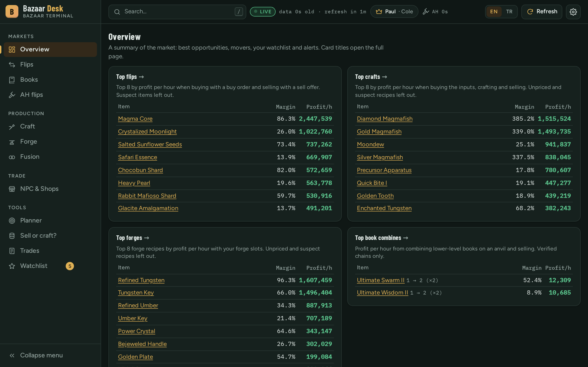
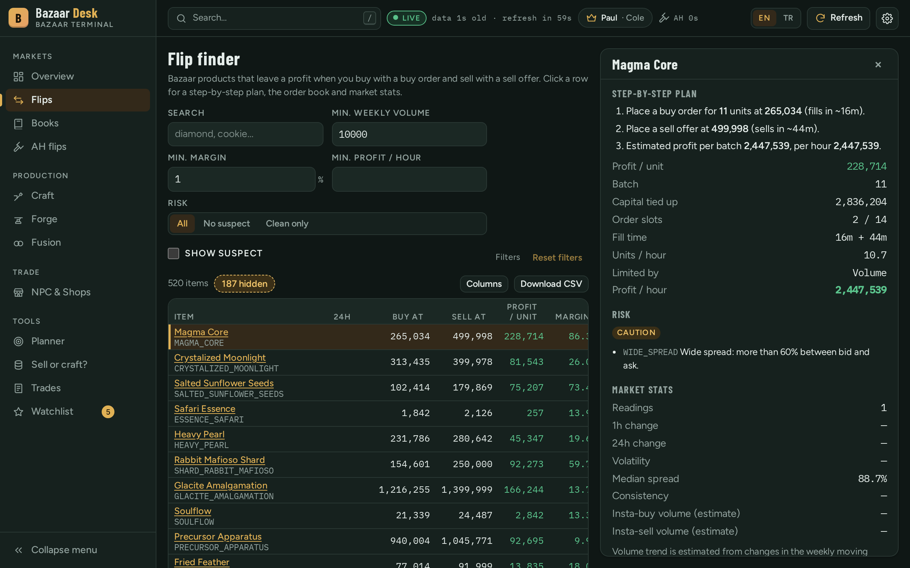
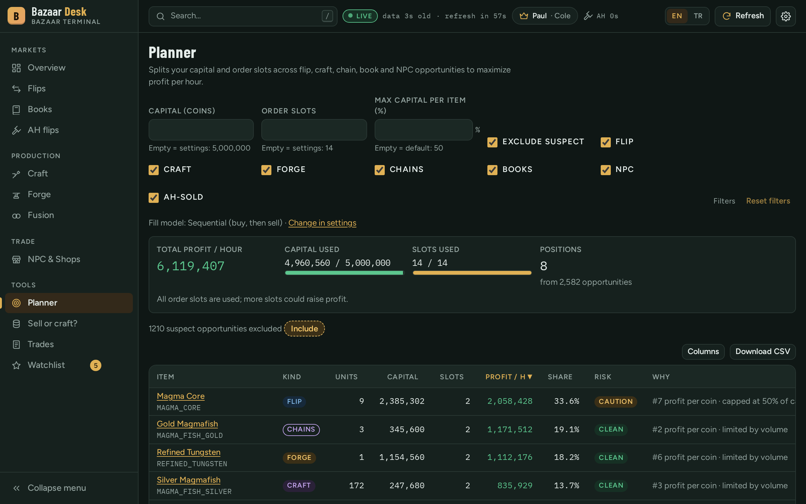
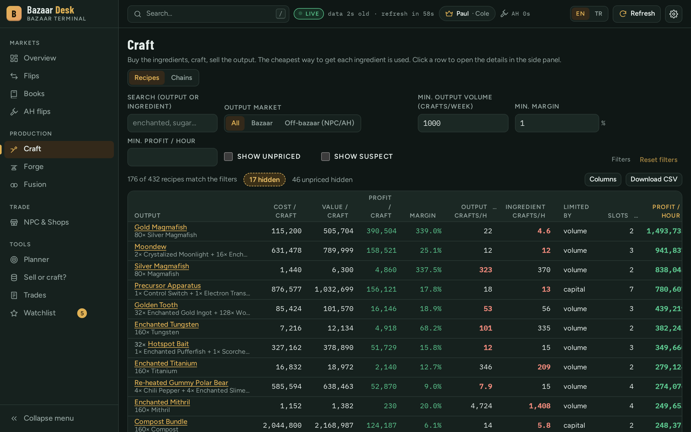
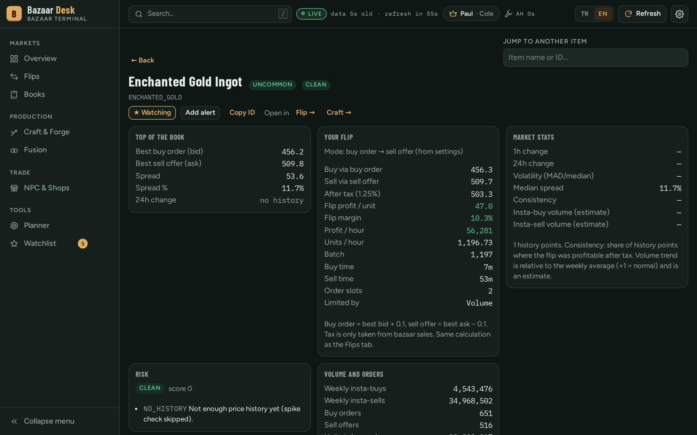
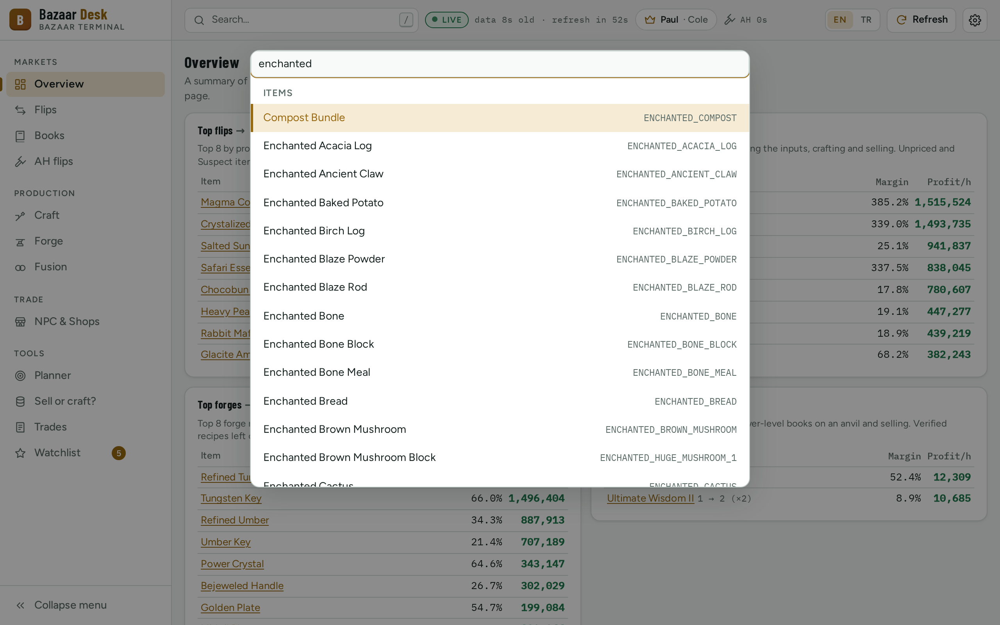
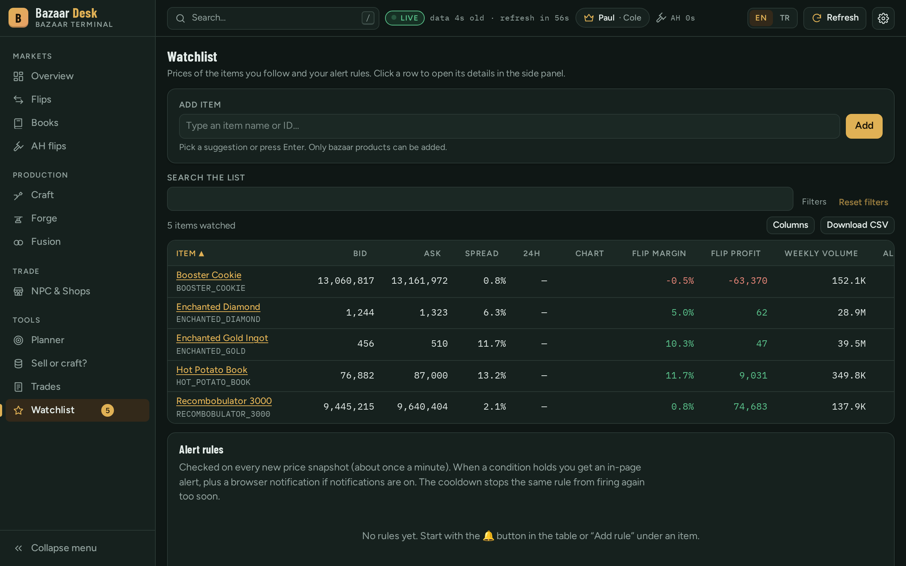
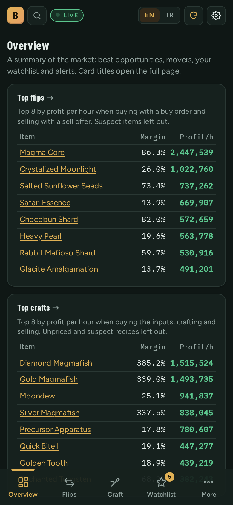
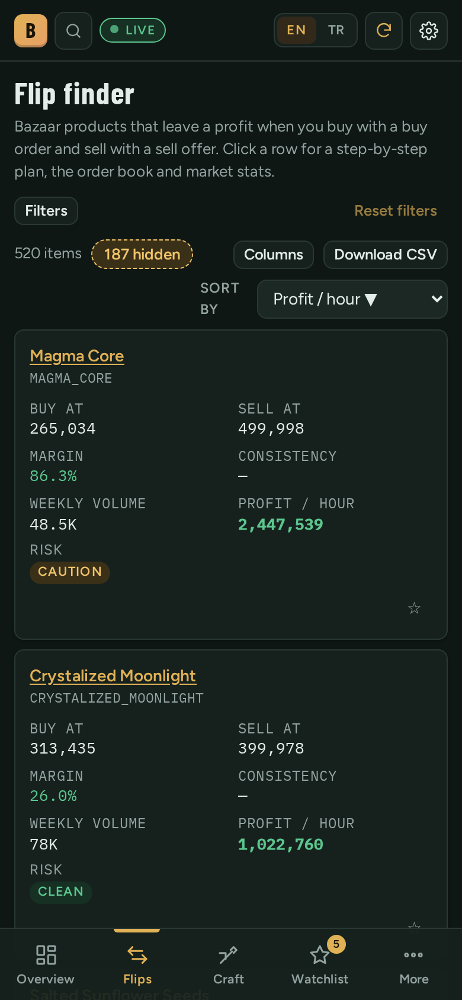
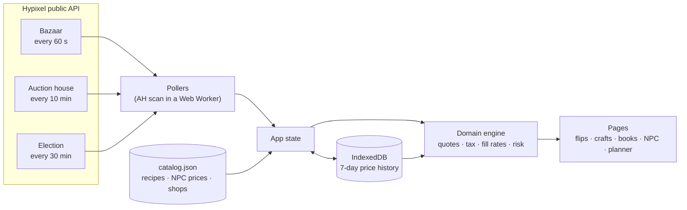

<div align="center">

# 🪙 Bazaar Desk

**A real-time trading terminal for the Hypixel SkyBlock bazaar.**<br>
Find flips, crafts, forges and book combines, then let the planner spread your coins across the best of them. Everything runs in your browser.

[](https://github.com/N1mblexe/Skyblock-MoneyPrinter/actions/workflows/pages.yml)


### [▶ Open the live app](https://n1mblexe.github.io/Skyblock-MoneyPrinter/) &nbsp;·&nbsp; [Quick start](#-quick-start) &nbsp;·&nbsp; [How it works](#-how-it-works)

<picture>
  <source media="(prefers-color-scheme: dark)" srcset="docs/images/overview-dark.png">
  <source media="(prefers-color-scheme: light)" srcset="docs/images/overview-light.png">
  
</picture>

</div>

> [!NOTE]
> Bazaar Desk only **reads public prices and does the math**. It never logs in, never needs an API key and never places orders in the game: you stay in control of every trade.

## ✨ Highlights

<table>
  <tr>
    <td width="33%" valign="top">
      <h3>📡 Live prices</h3>
      Bazaar order books every 60 s, a full auction-house lowest-BIN scan every 10 min, and the current mayor's perks.
    </td>
    <td width="33%" valign="top">
      <h3>🔁 Flip finder</h3>
      Buy-order → sell-offer profit after tax, with fill times, batch size and a step-by-step plan for every item.
    </td>
    <td width="33%" valign="top">
      <h3>⚒️ Craft &amp; forge</h3>
      Cheapest source for each ingredient (bazaar, NPC or sub-craft, 3 levels deep), sold to the bazaar, an NPC or the AH. A <b>Chains</b> tab finds multi-step ladders like Wheat → Ench. Wheat → Ench. Hay Bale.
    </td>
  </tr>
  <tr>
    <td valign="top">
      <h3>📚 Book combines</h3>
      Buy low-level enchanted books, combine them on an anvil and sell the higher level.
    </td>
    <td valign="top">
      <h3>🎯 Capital planner</h3>
      Splits your coins and order slots across flips, crafts, craft chains, books and NPC trades to maximize profit per hour.
    </td>
    <td valign="top">
      <h3>⭐ Watchlist &amp; alerts</h3>
      Track items, set price or margin rules and get notified. History is kept for 7 days in your browser.
    </td>
  </tr>
</table>

Plus NPC flips, currency-shop values (bits, copper, motes, …), shard-fusion recipes, risk flags on suspicious markets, a command palette, keyboard-first navigation, a mobile layout and an English / Turkish UI.

## 📸 Screenshots

<table>
  <tr>
    <td width="50%"><p align="center"><b>Flip finder</b>: click any row for a step-by-step plan</p></td>
    <td width="50%"><p align="center"><b>Planner</b>: your capital and order slots, allocated</p></td>
  </tr>
  <tr>
    <td><p align="center"><b>Craft &amp; Forge</b>: recipes ranked by profit per hour</p></td>
    <td><p align="center"><b>Item page</b>: order book, market stats, risk and recipes</p></td>
  </tr>
  <tr>
    <td><p align="center"><b>Command palette</b> (<kbd>/</kbd>), shown in the light theme</p></td>
    <td><p align="center"><b>Watchlist</b>: live prices and alert rules</p></td>
  </tr>
</table>

<details>
<summary><b>📱 Mobile layout</b></summary>
<br>
<p align="center">
  
  &nbsp;&nbsp;
  
</p>
</details>

## 🚀 Quick start

**Easiest:** open the [live app](https://n1mblexe.github.io/Skyblock-MoneyPrinter/). Nothing to install.

**Run it locally** (Node.js 20.19+ or 22.12+):

```sh
git clone https://github.com/N1mblexe/Skyblock-MoneyPrinter.git
cd Skyblock-MoneyPrinter
npm install
npm run dev        # → http://localhost:5173
```

The app opens in English. Switch to Turkish with the **EN / TR** buttons in the top bar, and set your capital, tax rate and order slots under ⚙️ **Settings**. Adding another language takes one folder of translations ([how](src/i18n/README.md)).

> [!TIP]
> If live prices can't be fetched, open Settings → Data → **Load prices manually** and paste or upload the JSON from <https://api.hypixel.net/v2/skyblock/bazaar>.

## 🧭 Pages

| page | hotkey | what it's for |
|---|:---:|---|
| 📊 **Overview** | <kbd>g</kbd> <kbd>o</kbd> | Best flips, crafts and book combines, price movers, watchlist, alerts and the mayor at a glance |
| 🔁 **Flips** | <kbd>g</kbd> <kbd>f</kbd> | Buy and sell the same bazaar product |
| 📚 **Books** | <kbd>g</kbd> <kbd>b</kbd> | Combine 2^(L−k) level-k books into one level-L book |
| ⚒️ **Craft & Forge** | <kbd>g</kbd> <kbd>c</kbd> | Buy ingredients, craft or forge, sell the result; the Chains tab covers multi-step ladders |
| 🧬 **Fusion** | <kbd>g</kbd> <kbd>u</kbd> | Your own shard-fusion recipes, editable, with import and export |
| 🏪 **NPC & Shops** | <kbd>g</kbd> <kbd>n</kbd> | Bazaar ↔ NPC flips and currency-shop offers valued in coins |
| 🎯 **Planner** | <kbd>g</kbd> <kbd>p</kbd> | Spread capital and order slots over every opportunity |
| ⭐ **Watchlist** | <kbd>g</kbd> <kbd>w</kbd> | Watched items, alert rules and the alert log |
| 🔍 **Item** | palette | One product in depth: order book, chart (3 h / 24 h / 7 d), risk, recipes |

Filters and sort orders are stored in the URL, so you can bookmark any filtered view.

<details>
<summary><b>⌨️ Keyboard shortcuts</b></summary>
<br>

| keys | action |
|---|---|
| <kbd>/</kbd> or <kbd>Ctrl</kbd>+<kbd>K</kbd> | Command palette (pages, items, actions) |
| <kbd>r</kbd> | Refresh prices |
| <kbd>?</kbd> | Shortcuts help |
| <kbd>Esc</kbd> | Close the dialog or panel |
| <kbd>g</kbd> then <kbd>o</kbd> <kbd>f</kbd> <kbd>c</kbd> <kbd>b</kbd> <kbd>n</kbd> <kbd>u</kbd> <kbd>p</kbd> <kbd>w</kbd> | Go to a page |
| <kbd>↑</kbd> <kbd>↓</kbd> or <kbd>j</kbd> <kbd>k</kbd>, then <kbd>Enter</kbd> | Move between table rows and open one |
| <kbd>s</kbd> | Watch or unwatch the selected row (Flips, Books) |
| <kbd>e</kbd> | Download the table as CSV (Flips, Books) |

</details>

## 🧠 How it works



Every number is an estimate built from the live order book:

- **Quotes come from the top of the book.** A buy order costs the best bid + 0.1 (never below 0.9 × the NPC price, never above the ask); a sell offer gets the ask − 0.1. Insta modes walk the book, so slippage is included.
- **Tax** (1.25 / 1.125 / 1 %) applies only to bazaar sales.
- **Fill rate** is your share of the weekly volume, split with the competing orders at the top of the book.
- **Throughput** per cycle is capped by volume, capital, book depth, forge slots, order slots and the NPC daily limit.
- **Risk flags** (dead bid, extreme spread, price spike, low volume, …) mark rows as *caution* or *suspect*; suspect rows are hidden by default.

📐 The full model, with formulas, is in **[docs/estimates.md](docs/estimates.md)**.

<details>
<summary><b>⚠️ What isn't modelled</b></summary>
<br>

- Anything that makes one AH item worth more than another with the same id (stars, reforges, enchantments, pet level)
- Collection and recipe requirements
- Changes to the order book while your orders fill
- The anvil XP cost of combining books
- Fusion fees
- Minion profits and automatic shard-fusion candidates (there's no usable data for them)

</details>

## 🔒 Privacy

All data stays in your browser: settings, watchlist and alerts in `localStorage`, price history and the last AH scan in IndexedDB. There is no backend, account or tracking.

## 🛠️ Development

Built with **vanilla TypeScript + Vite**, no UI framework. The calculation code in `src/domain/` is pure and covered by unit tests (95 % line coverage required).

```sh
npm test               # unit tests (vitest)
npm run build          # typecheck + production build
npm run smoke          # headless browser test of the build
npm run screenshots    # regenerate the images in this README
```

Scripts, data sources, storage keys, project layout and deployment are documented in **[docs/development.md](docs/development.md)**.

---

<div align="center">
<sub>
Prices from the <a href="https://api.hypixel.net/">Hypixel API</a> · recipes and shop data from the <a href="https://github.com/NotEnoughUpdates/NotEnoughUpdates-REPO">NEU repo</a><br>
Not affiliated with or endorsed by Hypixel Inc. or Mojang.
</sub>
</div>
